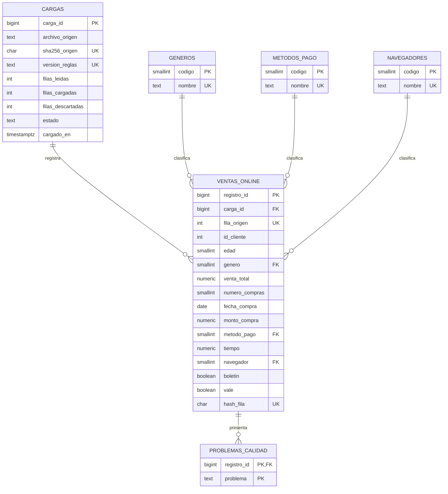
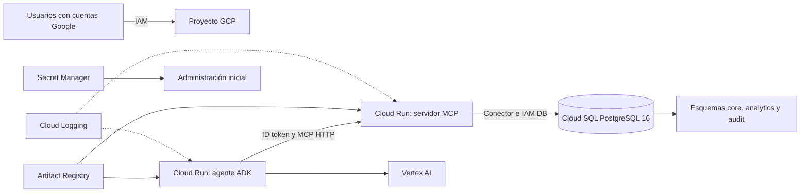

# Documentación de la práctica

Este documento presenta la preparación de datos, el modelo relacional, la arquitectura,
los permisos, la ejecución local, el despliegue, el contrato de integración, las
validaciones y los apartados del informe final.

## 1. Organización del trabajo

| Responsable | Área de trabajo |
|---|---|
| Dominic | Preparación y validación de datos, modelo relacional, PostgreSQL, infraestructura en GCP y servidor MCP base. |
| Monjes | Análisis descriptivo, tendencias, segmentación, correlación, visualizaciones e informe. |
| Yania | Agente con Google ADK, herramientas MCP, integración, pruebas y despliegue del agente. |

La secuencia de trabajo parte de la preparación de los datos y el modelo relacional,
continúa con las funciones de análisis y finaliza con la integración del agente y la
validación conjunta de los resultados.

### Herramientas seleccionadas

| Herramienta | Uso | Justificación |
|---|---|---|
| Python | Limpieza, análisis y servidor MCP | Permite implementar procesos reproducibles y funciones reutilizables. |
| PostgreSQL 16 | Base de datos relacional | Proporciona tipos, restricciones, roles y consultas SQL. |
| Google Cloud SQL | PostgreSQL en la nube | Cumple el requisito de utilizar una base relacional administrada en la nube. |
| Docker | Entorno local y construcción de imágenes | Mantiene las mismas dependencias sin instalar PostgreSQL en cada equipo. |
| Artifact Registry | Almacenamiento de imágenes | Integra las imágenes de contenedor con los despliegues de Google Cloud. |
| Cloud Run | Ejecución del MCP y del agente | Ejecuta contenedores administrados con escalado y cuentas de servicio. |
| Google ADK | Agente conversacional | Proporciona la estructura requerida para integrar el modelo y las herramientas. |
| MCP | Herramientas de consulta y análisis | Define una interfaz común entre el agente, las funciones y PostgreSQL. |
| GitHub | Control de versiones | Centraliza el código y los cambios del equipo. |

### Cronograma

| Fase | Periodo |
|---|---|
| Preparación de datos y modelo relacional | `<PERIODO_FASE_1>` |
| Análisis y visualizaciones | `<PERIODO_FASE_2>` |
| Agente e integración MCP | `<PERIODO_FASE_3>` |
| Validación y elaboración del informe | `<PERIODO_FASE_4>` |

## 2. Entorno técnico

### Resultados locales

- CSV original revisado: 1,008 filas y 12 columnas.
- CSV limpio: 1,003 filas después de eliminar 5 duplicados exactos.
- PostgreSQL 16 probado con 1,003 registros cargados.
- Roles internos de migración, carga, análisis y MCP probados localmente.
- Servidor MCP base probado mediante Streamable HTTP.
- Herramienta `verificar_conexion_postgresql` probada con una conexión real.
- Arquitectura y procedimiento de despliegue definidos para Google Cloud.

### Entorno revisado

| Componente | Estado |
|---|---|
| Sistema | Ubuntu 24.04.4 LTS sobre WSL2, x86_64 |
| `gcloud` | 583.0.0 instalado |
| Git | 2.43.0 instalado |
| Python | 3.12.3 instalado |
| Docker | 29.1.3, cliente y servidor disponibles |
| Docker Compose | 1.29.2 como `docker-compose` |
| PostgreSQL y `psql` locales | No instalados; se usa `postgres:16-alpine` |
| Cloud SQL Auth Proxy | Imagen oficial disponible mediante Docker |

No fue necesario instalar PostgreSQL ni dependencias de Python en el sistema. Docker
contiene la base de datos y las librerías del MCP.

### Archivos principales

```text
data/processed/ventas_online_2025_limpio.csv  Datos listos para cargar
data/processed/reporte_calidad.json           Conteos de la limpieza
sql/001_esquema.sql                           Esquemas, tablas, catálogos y vista
sql/002_permisos.sql                          Roles internos y privilegios
sql/003_carga.sql                             Carga repetible del CSV limpio
src/sog2/cleaning.py                          Limpieza y validación
src/sog2/database.py                          Conexión local o con Cloud SQL
src/sog2/server.py                            Servidor MCP base
compose.yaml                                  PostgreSQL y MCP locales
Dockerfile                                    Imagen del MCP
```

## 3. Preparación, limpieza y validación del CSV

### Identificación del conjunto

| Dato | Resultado |
|---|---:|
| Archivo | `ventas_online_2025.csv` |
| SHA-256 del archivo original | `a83e8c253c018d27f68d972436687c86fd64e04dd8d61db2dd409e0ff765a703` |
| Codificación | UTF-8 |
| Columnas | 12 |
| Filas leídas | 1,008 |
| Filas limpias | 1,003 |
| IDs de cliente distintos | 1,000 |
| Periodo | 2025-01-01 a 2025-12-28 |

El grano conservado es una fila del archivo fuente. `Id_cliente` no es único: los
clientes 198, 402 y 559 aparecen dos veces con fechas o montos diferentes. Como el CSV
no incluye una llave de transacción, esas filas no se eliminaron.

### Reglas aplicadas

1. Se comprueba que existan exactamente las 12 columnas indicadas en el enunciado.
2. Solo se elimina una fila cuando sus 12 valores originales son iguales a los de una fila anterior.
3. Se conservan las primeras apariciones y se eliminan las líneas físicas 1002 a 1006, duplicadas para los clientes 101 a 105.
4. Se conserva `fila_origen` para rastrear el registro hasta el CSV original.
5. Se genera `hash_fila` a partir de la fila limpia para evitar duplicar la misma versión del registro.
6. `Id_cliente` se convierte a entero positivo; un identificador inválido detiene la limpieza.
7. `Edad` se convierte a entero; vacíos, valores menores o iguales a cero y mayores a 100 quedan nulos.
8. Las edades de 12 a 17 se conservan y se marcan porque el enunciado no limita las ventas a adultos.
9. `Genero` acepta 0 y 1, y recupera `Masculino` como 0 y `Femenino` como 1; otros valores quedan nulos.
10. `Venta_total` y `MontoCompra` eliminan espacios, símbolo de dólar y comillas internas.
11. Los montos aceptan punto decimal, coma decimal y separador de miles, y se guardan con dos decimales.
12. Los montos negativos se conservan porque podrían representar devoluciones o ajustes.
13. `N_Compras` se convierte a entero no negativo; un cero con venta distinta de cero se marca.
14. Las fechas aceptan `AAAA/MM/DD`, `AAAA-MM-DD`, `MM/DD/AAAA` y `DD-MM-AAAA`, y se normalizan como `AAAA-MM-DD`.
15. `MetodoPago` acepta 0, 1 y 2; otros valores quedan nulos.
16. `Tiempo` se convierte a decimal no negativo y no se cambia su unidad porque la fuente no la define.
17. `Navegador` acepta valores de 0 a 4; otros valores quedan nulos.
18. `Boletín` y `Vale` aceptan 0, 1, `Sí`, `Si` y `No`; otros valores quedan nulos.
19. No se imputan valores con media, moda ni otra técnica que confunda datos observados con estimaciones.
20. Cada fila conserva sus incidencias en `problemas_calidad`, separadas por `|`.

### Resultado de calidad

| Incidencia | Filas conservadas |
|---|---:|
| Edad faltante | 8 |
| Edad fuera de 1 a 100 | 28 |
| Edad menor de 18, conservada | 11 |
| Género faltante | 14 |
| Género inválido | 61 |
| Género textual recuperado | 17 |
| Método de pago faltante | 11 |
| Método de pago inválido | 89 |
| Navegador faltante | 19 |
| Navegador inválido | 64 |
| Boletín faltante | 15 |
| Boletín inválido | 58 |
| Boletín textual recuperado | 15 |
| Vale faltante | 18 |
| Vale inválido | 56 |
| Vale textual recuperado | 25 |
| Venta total negativa, conservada | 63 |
| Monto de compra negativo, conservado | 57 |
| Número de compras cero con venta distinta de cero | 88 |
| Monto de compra mayor que venta total no negativa | 431 |

Se normalizaron 225 valores de `Venta_total` y 237 valores de `MontoCompra` que
contenían espacios, símbolos, comas, comillas o una cantidad incompleta de decimales.

### Criterios para el análisis

- No tratar `Id_cliente` como una llave única.
- No convertir valores nulos a cero.
- No eliminar montos negativos sin explicar el filtro.
- No asumir la unidad de `Tiempo`.
- No afirmar que `MontoCompra` debe ser menor o igual que `Venta_total`.
- No sumar filas por cliente sin indicar que existen tres identificadores repetidos.

El archivo `data/processed/reporte_calidad.json` conserva los conteos generados por el
programa de limpieza. Al ejecutar de nuevo el proceso se reemplazan las salidas con el
mismo resultado para el mismo archivo fuente.

## 4. Modelo relacional y diccionario de datos

El modelo mantiene cada fila válida, separa los dominios codificados y registra la
calidad en un esquema de auditoría. `Id_cliente` no es llave primaria porque hay tres
clientes repetidos con datos diferentes.



### Esquemas

- `staging`: recepción temporal del CSV limpio.
- `core`: datos tipados y catálogos.
- `analytics`: vista estable para análisis y MCP.
- `audit`: cargas y problemas de calidad.

La carga usa `fila_origen` para actualizar registros existentes. Ejecutarla varias veces
deja 1,003 filas y no crea copias adicionales.

### Tabla `core.ventas_online`

| Campo | Tipo PostgreSQL | Nulo | Descripción |
|---|---|---|---|
| `registro_id` | `BIGINT` identidad | No | Llave técnica de cada fila conservada. |
| `carga_id` | `BIGINT` | No | Llave foránea a `audit.cargas`. |
| `fila_origen` | `INTEGER` | No | Línea del CSV contando el encabezado; es única. |
| `id_cliente` | `INTEGER` | No | Identificador del archivo; no es único. |
| `edad` | `SMALLINT` | Sí | Edad de 1 a 100; valores imposibles quedan nulos. |
| `genero` | `SMALLINT` | Sí | 0 masculino y 1 femenino. |
| `venta_total` | `NUMERIC(12,2)` | No | Venta total normalizada; puede ser negativa. |
| `numero_compras` | `SMALLINT` | No | Entero mayor o igual que cero. |
| `fecha_compra` | `DATE` | No | Fecha normalizada del año 2025. |
| `monto_compra` | `NUMERIC(12,2)` | No | Monto normalizado; puede ser negativo. |
| `metodo_pago` | `SMALLINT` | Sí | 0 efectivo, 1 crédito y 2 débito. |
| `tiempo` | `NUMERIC(8,2)` | No | Tiempo no negativo; la unidad no está especificada. |
| `navegador` | `SMALLINT` | Sí | 0 tienda física y 1 a 4 navegadores. |
| `boletin` | `BOOLEAN` | Sí | Verdadero, falso o nulo si el dato no fue válido. |
| `vale` | `BOOLEAN` | Sí | Verdadero, falso o nulo si el dato no fue válido. |
| `hash_fila` | `CHAR(64)` | No | Identificador calculado de la versión limpia de la fila. |
| `cargado_en` | `TIMESTAMPTZ` | No | Fecha y hora de carga. |

### Catálogos

| Tabla | Código | Nombre |
|---|---:|---|
| `core.generos` | 0 | Masculino |
| `core.generos` | 1 | Femenino |
| `core.metodos_pago` | 0 | Efectivo |
| `core.metodos_pago` | 1 | Tarjeta de crédito |
| `core.metodos_pago` | 2 | Tarjeta de débito |
| `core.navegadores` | 0 | Tienda física |
| `core.navegadores` | 1 | Navegador 1 |
| `core.navegadores` | 2 | Navegador 2 |
| `core.navegadores` | 3 | Navegador 3 |
| `core.navegadores` | 4 | Navegador 4 |

### Auditoría y consulta

`audit.cargas` registra el archivo, su SHA-256, la versión de las reglas, filas leídas,
cargadas y descartadas, estado, usuario y fecha. `audit.problemas_calidad` contiene una
fila por incidencia y registro. La vista `analytics.ventas_detalle` agrega las etiquetas
de los catálogos y deriva `anio` y `mes`; es la entrada utilizada por las funciones de
análisis y por las herramientas de lectura del MCP.

## 5. Infraestructura, seguridad y costos en Google Cloud

### Arquitectura diseñada



Se usan dos cuentas de servicio: `sog2-mcp-runtime` conecta con Cloud SQL y consulta la
vista analítica, mientras `sog2-adk-runtime` usa Vertex AI e invoca el servicio privado
del MCP. El agente no entra directamente a PostgreSQL y no se utilizan llaves JSON.

Cloud SQL utiliza IP pública sin redes autorizadas y
`connectorEnforcement=REQUIRED`, que obliga a usar Cloud SQL Auth Proxy o un conector
oficial. Esta configuración evita una VPC adicional y mantiene bloqueadas las conexiones
directas a la instancia.

### Recursos de Google Cloud

| Recurso | Nombre | Configuración |
|---|---|---|
| Proyecto | `<PROJECT_ID>` | Proyecto de la práctica. |
| Región | `us-central1` | Región principal. |
| Artifact Registry | `sog2-images` | Repositorio Docker regional. |
| Cloud SQL | `sog2-postgres` | PostgreSQL 16, una zona, sin alta disponibilidad. |
| Base de datos | `ventas_online` | Esquemas `staging`, `core`, `analytics` y `audit`. |
| Cuenta MCP | `sog2-mcp-runtime` | Identidad del servidor MCP. |
| Cuenta ADK | `sog2-adk-runtime` | Identidad del agente. |
| Cloud Run MCP | `sog2-mcp` | Servicio privado, mínimo cero instancias. |
| Cloud Run ADK | `sog2-adk` | Servicio privado del agente. |
| Secreto | `sog2-db-admin-password` | Solo para administración inicial. |
| Presupuesto | `sog2-practica-budget` | Alertas al 50 %, 80 % y 100 %. |

### APIs necesarias

| API | Uso |
|---|---|
| `serviceusage.googleapis.com` | Activación y consulta de APIs. |
| `cloudresourcemanager.googleapis.com` | Proyecto y políticas IAM. |
| `cloudbilling.googleapis.com` | Facturación del proyecto. |
| `billingbudgets.googleapis.com` | Presupuesto y alertas. |
| `artifactregistry.googleapis.com` | Imágenes de contenedor. |
| `run.googleapis.com` | Servicios Cloud Run. |
| `sqladmin.googleapis.com` | Cloud SQL y conectores. |
| `secretmanager.googleapis.com` | Contraseña administrativa y secretos de infraestructura. |
| `iam.googleapis.com` | Cuentas de servicio. |
| `iamcredentials.googleapis.com` | Tokens temporales e impersonación. |
| `aiplatform.googleapis.com` | Modelo usado por Google ADK. |
| `logging.googleapis.com` | Logs. |
| `monitoring.googleapis.com` | Métricas y canales de alerta. |

Cloud Build no forma parte del flujo. Las imágenes se construyen con Docker y se
publican directamente en Artifact Registry.

### Identidades y niveles de autorización

Una persona se identifica con su correo, contraseña y MFA. Cada usuario emplea su propio
correo y nunca comparte contraseña. Una cuenta de servicio identifica a una aplicación;
Cloud Run le entrega credenciales temporales sin guardar una llave en el repositorio.

IAM controla el acceso a los recursos de Google Cloud. Por ejemplo,
`roles/cloudsql.client` permite abrir una conexión por el conector, pero no concede
`SELECT` en PostgreSQL. Los roles internos de PostgreSQL controlan lo que puede hacerse
después de conectarse. Para usar IAM Database Authentication se necesitan ambos niveles.

### Matriz IAM de mínimo privilegio

No se asignan `Owner`, `Editor`, `Billing Admin` ni `Project IAM Admin`. Los roles de
Dominic se omiten cuando sus permisos efectivos ya incluyen la operación necesaria.

| Identidad | Alcance | Rol IAM | Motivo |
|---|---|---|---|
| Dominic `<DOMINIC_EMAIL>` | Proyecto | `roles/serviceusage.serviceUsageAdmin` | Activar APIs cuando no existe un permiso equivalente. |
| Dominic | Proyecto | `roles/artifactregistry.admin` | Crear y administrar el repositorio. |
| Dominic | Proyecto | `roles/run.admin` | Crear y configurar servicios. |
| Dominic | Proyecto | `roles/iam.serviceAccountAdmin` | Crear las cuentas de servicio sin administrar todo IAM. |
| Dominic | Cuentas MCP y ADK | `roles/iam.serviceAccountUser` | Desplegar únicamente con esas identidades. |
| Dominic | Proyecto | `roles/secretmanager.admin` | Crear y rotar el secreto administrativo. |
| Dominic | Proyecto | `roles/cloudsql.admin`, temporal | Aprovisionar la instancia y usuarios; se retira después. |
| Dominic | Proyecto | `roles/cloudsql.client` y `roles/cloudsql.instanceUser` | Conectarse después del aprovisionamiento. |
| Dominic | Proyecto | `roles/logging.viewer` y `roles/monitoring.viewer` | Revisar ejecución y métricas. |
| Dominic | Cuenta de facturación | `roles/billing.user` | Vincular la facturación si el propietario lo autoriza. |
| Dominic | Cuenta de facturación | `roles/billing.costsManager` | Crear el presupuesto sin administrar pagos. |
| Dominic | Proyecto | `roles/billing.projectManager` | Vincular o desvincular facturación. |
| Monjes `javiermonjesnuevo@gmail.com` | Proyecto | `roles/cloudsql.client` y `roles/cloudsql.instanceUser` | Conexión de solo lectura mediante IAM. |
| Yania `<YANIA_EMAIL>` | Proyecto | `roles/run.developer` | Desplegar revisiones sin administrar IAM. |
| Yania | Repositorio `sog2-images` | `roles/artifactregistry.writer` | Publicar la imagen del agente. |
| Yania | Proyecto | `roles/logging.viewer` | Revisar la integración. |
| Yania | Cuenta `sog2-adk-runtime` | `roles/iam.serviceAccountUser` | Desplegar únicamente como el agente. |
| Yania | Servicio `sog2-mcp` | `roles/run.invoker` | Invocar y probar el MCP privado. |
| Yania | Proyecto | `roles/aiplatform.user` | Ejecutar el modelo configurado. |
| `sog2-mcp-runtime` | Proyecto | `roles/cloudsql.client` y `roles/cloudsql.instanceUser` | Conexión IAM con Cloud SQL. |
| `sog2-adk-runtime` | Proyecto | `roles/aiplatform.user` | Uso del modelo en Vertex AI. |
| `sog2-adk-runtime` | Servicio `sog2-mcp` | `roles/run.invoker` | Comunicación privada entre agente y MCP. |

Yania no requiere acceso directo a Cloud SQL para integrar el agente. Las comparaciones
temporales por SQL utilizan `roles/cloudsql.client`, `roles/cloudsql.instanceUser` y el
rol interno `sog2_analyst_ro`.

`roles/cloudsql.editor` no permite crear o eliminar instancias ni administrar usuarios,
por lo que no sustituye el permiso temporal de aprovisionamiento. Si Dominic ya tiene un
rol heredado con `cloudsql.instances.create`, no se agrega `roles/cloudsql.admin`.

### Permisos internos de PostgreSQL

| Identidad | Rol PostgreSQL | Acceso |
|---|---|---|
| Dominic | `sog2_migrator` y `sog2_loader` | Cambios de esquema y carga controlada. |
| Monjes | `sog2_analyst_ro` | `CONNECT`, `USAGE` y `SELECT` en `core` y `analytics`. |
| Yania, para comparación SQL | `sog2_analyst_ro` | Lectura temporal, sin cambios. |
| `sog2-mcp-runtime` | `sog2_mcp_ro` | `CONNECT`, `USAGE` y `SELECT` solo en `analytics`. |
| `sog2-adk-runtime` | Ninguno | No entra a PostgreSQL. |
| Usuario `postgres` | Administración inicial | Su contraseña está en Secret Manager y no la usa la aplicación. |

Los roles son `NOLOGIN`. Los usuarios IAM reciben membresía al crearlos con
`gcloud sql users create --database-roles=...` y se autentican con tokens temporales.

### Riesgos de seguridad

- Ejecutar comandos sobre un proyecto distinto al de la práctica.
- Guardar contraseñas, ADC, tokens, archivos `.env` o llaves JSON en Git.
- Publicar el MCP o entregar escritura SQL a quien solo necesita consultar.
- Confundir `Cloud SQL Client` con permiso para leer tablas.
- Dar `Service Account User` sobre todo el proyecto en vez de una cuenta específica.
- Escribir tokens o encabezados `Authorization` en los logs.
- Ejecutar Cloud Run con el usuario PostgreSQL `postgres`.
- Interpretar nulos o montos negativos sin respetar las reglas de limpieza.
- Desactivar la protección de borrado antes de conservar los resultados necesarios.

### Riesgos de costo

- Cloud SQL factura mientras la instancia existe, aunque no reciba consultas.
- El almacenamiento y las copias automáticas pueden seguir generando consumo.
- Artifact Registry cobra por imágenes almacenadas.
- Cloud Run puede escalar si no se limita el máximo de instancias.
- Vertex AI depende del modelo y del volumen de solicitudes.
- Los logs excesivos generan almacenamiento adicional.
- Un presupuesto genera alertas, pero no detiene el gasto.

La configuración usa una instancia pequeña de una zona, 10 GB, sin réplica y Cloud Run
con mínimo cero y máximo dos instancias. Los recursos se eliminan al concluir su periodo
de uso.

### Parámetros del despliegue

| Parámetro | Valor |
|---|---|
| ID del proyecto | `<PROJECT_ID>` |
| Nombre del proyecto | `SOG2 Grupo 15` |
| Región | `us-central1` |
| Cuenta de facturación | `<BILLING_ACCOUNT_ID>` |
| Presupuesto | `<BUDGET_AMOUNT>` |
| Correo de Dominic | `<DOMINIC_EMAIL>` |
| Correo de Monjes | `javiermonjesnuevo@gmail.com` |
| Correo de Yania | `<YANIA_EMAIL>` |
| Tipo de instancia Cloud SQL | `<TIER>` |
| Modelo de Vertex AI | `<MODEL_ID>` |

## 6. Guía técnica de ejecución local

El entorno local se reproduce con Python, Docker y Docker Compose.

### Limpieza

La limpieza usa la biblioteca estándar de Python:

```bash
python3 src/sog2/cleaning.py
```

El comando actualiza el CSV limpio y el reporte de calidad. No modifica el archivo
original.

### PostgreSQL y MCP con Docker

La contraseña local se define en la terminal y no se guarda en el repositorio:

```bash
export POSTGRES_PASSWORD=<CONTRASENA_LOCAL>
docker-compose up -d db
docker-compose exec -T db psql -U postgres -d ventas_online -f sql/001_esquema.sql
docker-compose exec -T db psql -U postgres -d ventas_online -f sql/002_permisos.sql
docker-compose exec -T db psql -U postgres -d ventas_online -f sql/003_carga.sql
docker-compose build mcp
docker-compose up -d mcp
curl http://127.0.0.1:8080/health
```

En equipos con Docker Compose moderno puede usarse `docker compose` en lugar de
`docker-compose`.

Para revisar los servicios y los logs:

```bash
docker-compose ps
docker-compose logs --tail=100 mcp
```

Para detenerlos sin eliminar la base local:

```bash
docker-compose stop
```

### Acceso a la solución

| Usuario o servicio | Acceso |
|---|---|
| Dominic | Migración, carga y administración de la infraestructura. |
| Monjes | Consulta de `analytics.ventas_detalle` y `core`, sin escritura. |
| Yania | Despliegue del agente e invocación del endpoint `/mcp`. |
| `sog2-mcp-runtime` | Consulta de la capa `analytics`. |
| `sog2-adk-runtime` | Vertex AI e invocación privada del MCP. |

`verificar_conexion_postgresql` comprueba la conectividad inicial. Los secretos se
administran mediante IAM y Secret Manager y no forman parte del repositorio.

### Uso del agente conversacional

`<DESCRIPCION_DE_USO_DEL_AGENTE>`

## 7. Despliegue en Google Cloud

Los valores entre `< >` representan datos propios del proyecto y se sustituyen antes de
ejecutar los comandos.

### Orden exacto de implementación

1. Confirmar proyecto, región, facturación, presupuesto y correos.
2. Iniciar sesión personalmente y comprobar la cuenta activa.
3. Crear o seleccionar el proyecto confirmado.
4. Vincular facturación y crear el presupuesto antes de Cloud SQL.
5. Activar solamente las APIs listadas.
6. Crear Artifact Registry.
7. Crear las cuentas de servicio del MCP y ADK.
8. Aplicar IAM humano y de ejecución con los alcances definidos.
9. Crear el secreto administrativo y Cloud SQL PostgreSQL 16.
10. Activar IAM Database Authentication y exigir conectores.
11. Crear la base `ventas_online`.
12. Abrir un Cloud SQL Auth Proxy temporal y aplicar el esquema y los permisos.
13. Ejecutar el limpiador y cargar el CSV con `sog2_loader`.
14. Crear los usuarios IAM de base de datos y asignar roles internos.
15. Construir y publicar la imagen MCP.
16. Desplegar el MCP privado como `sog2-mcp-runtime`.
17. Probar `verificar_conexion_postgresql`.
18. Revisar logs, presupuesto, IAM y ausencia de secretos en Git.
19. Eliminar los recursos al concluir la práctica.

### Variables de la sesión

```bash
export PROJECT_ID=<PROJECT_ID>
export PROJECT_NAME="SOG2 Grupo 15"
export REGION=us-central1
export BILLING_ACCOUNT=<BILLING_ACCOUNT_ID>
export BUDGET_AMOUNT=<BUDGET_AMOUNT>
export DOMINIC_EMAIL=<DOMINIC_EMAIL>
export MONJES_EMAIL=javiermonjesnuevo@gmail.com
export YANIA_EMAIL=<YANIA_EMAIL>
export SQL_INSTANCE=sog2-postgres
export DB_NAME=ventas_online
export AR_REPOSITORY=sog2-images
export MCP_SERVICE=sog2-mcp
export MCP_SA=sog2-mcp-runtime
export ADK_SA=sog2-adk-runtime
```

Estas variables no contienen contraseñas y se pierden al cerrar la terminal.

### Autenticación personal

```bash
gcloud auth login
gcloud auth list
gcloud config configurations create sog2-grupo15
gcloud config set account "$DOMINIC_EMAIL"
```

El inicio de sesión y MFA se realizan en el navegador con la cuenta de Dominic. Cada
usuario mantiene sus propias credenciales.

### Proyecto, facturación y presupuesto

```bash
gcloud projects create "$PROJECT_ID" --name="$PROJECT_NAME"
gcloud config set project "$PROJECT_ID"
gcloud billing projects link "$PROJECT_ID" --billing-account="$BILLING_ACCOUNT"
gcloud billing projects describe "$PROJECT_ID"
```

Antes de crear Cloud SQL:

```bash
gcloud services enable billingbudgets.googleapis.com
gcloud billing budgets create \
  --billing-account="$BILLING_ACCOUNT" \
  --display-name="sog2-practica-budget" \
  --budget-amount="$BUDGET_AMOUNT" \
  --filter-projects="projects/$PROJECT_ID" \
  --threshold-rule=percent=0.50 \
  --threshold-rule=percent=0.80 \
  --threshold-rule=percent=1.00
```

Las alertas avisan sobre el consumo, pero no lo detienen.

### Activación de APIs

```bash
gcloud services enable \
  serviceusage.googleapis.com \
  cloudresourcemanager.googleapis.com \
  cloudbilling.googleapis.com \
  billingbudgets.googleapis.com \
  artifactregistry.googleapis.com \
  run.googleapis.com \
  sqladmin.googleapis.com \
  secretmanager.googleapis.com \
  iam.googleapis.com \
  iamcredentials.googleapis.com \
  aiplatform.googleapis.com \
  logging.googleapis.com \
  monitoring.googleapis.com
```

### Artifact Registry y cuentas de servicio

```bash
gcloud artifacts repositories create "$AR_REPOSITORY" \
  --repository-format=docker \
  --location="$REGION" \
  --description="Imagenes de la practica SOG2"

gcloud iam service-accounts create "$MCP_SA" \
  --display-name="Ejecucion MCP ventas"

gcloud iam service-accounts create "$ADK_SA" \
  --display-name="Ejecucion agente ADK"
```

Las identidades resultantes son:

```text
sog2-mcp-runtime@<PROJECT_ID>.iam.gserviceaccount.com
sog2-adk-runtime@<PROJECT_ID>.iam.gserviceaccount.com
```

### IAM de ejecución

```bash
gcloud projects add-iam-policy-binding "$PROJECT_ID" \
  --member="serviceAccount:$MCP_SA@$PROJECT_ID.iam.gserviceaccount.com" \
  --role="roles/cloudsql.client"

gcloud projects add-iam-policy-binding "$PROJECT_ID" \
  --member="serviceAccount:$MCP_SA@$PROJECT_ID.iam.gserviceaccount.com" \
  --role="roles/cloudsql.instanceUser"

gcloud projects add-iam-policy-binding "$PROJECT_ID" \
  --member="serviceAccount:$ADK_SA@$PROJECT_ID.iam.gserviceaccount.com" \
  --role="roles/aiplatform.user"
```

Permiso de Dominic para desplegar con las cuentas de servicio:

```bash
gcloud iam service-accounts add-iam-policy-binding \
  "$MCP_SA@$PROJECT_ID.iam.gserviceaccount.com" \
  --member="user:$DOMINIC_EMAIL" \
  --role="roles/iam.serviceAccountUser"

gcloud iam service-accounts add-iam-policy-binding \
  "$ADK_SA@$PROJECT_ID.iam.gserviceaccount.com" \
  --member="user:$DOMINIC_EMAIL" \
  --role="roles/iam.serviceAccountUser"
```

Acceso humano a Cloud SQL:

```bash
gcloud projects add-iam-policy-binding "$PROJECT_ID" \
  --member="user:$DOMINIC_EMAIL" \
  --role="roles/cloudsql.client"

gcloud projects add-iam-policy-binding "$PROJECT_ID" \
  --member="user:$DOMINIC_EMAIL" \
  --role="roles/cloudsql.instanceUser"

gcloud projects add-iam-policy-binding "$PROJECT_ID" \
  --member="user:$MONJES_EMAIL" \
  --role="roles/cloudsql.client"

gcloud projects add-iam-policy-binding "$PROJECT_ID" \
  --member="user:$MONJES_EMAIL" \
  --role="roles/cloudsql.instanceUser"
```

Acceso de Yania:

```bash
gcloud projects add-iam-policy-binding "$PROJECT_ID" \
  --member="user:$YANIA_EMAIL" \
  --role="roles/run.developer"

gcloud projects add-iam-policy-binding "$PROJECT_ID" \
  --member="user:$YANIA_EMAIL" \
  --role="roles/logging.viewer"

gcloud projects add-iam-policy-binding "$PROJECT_ID" \
  --member="user:$YANIA_EMAIL" \
  --role="roles/aiplatform.user"

gcloud artifacts repositories add-iam-policy-binding "$AR_REPOSITORY" \
  --location="$REGION" \
  --member="user:$YANIA_EMAIL" \
  --role="roles/artifactregistry.writer"

gcloud iam service-accounts add-iam-policy-binding \
  "$ADK_SA@$PROJECT_ID.iam.gserviceaccount.com" \
  --member="user:$YANIA_EMAIL" \
  --role="roles/iam.serviceAccountUser"
```

La invocación del MCP se concede después de desplegarlo. No se asigna
`Service Account User` a nivel de proyecto.

### Secreto y Cloud SQL

La contraseña administrativa debe ser aleatoria y diferente de la contraseña usada en
el entorno local.

```bash
gcloud secrets create sog2-db-admin-password \
  --replication-policy=automatic
```

La versión del secreto se agrega sin dejar la contraseña en el historial:

```bash
read -s -p "Contraseña administrativa: " DB_ADMIN_PASSWORD
printf '%s' "$DB_ADMIN_PASSWORD" | gcloud secrets versions add \
  sog2-db-admin-password --data-file=-
unset DB_ADMIN_PASSWORD
```

La instancia se crea únicamente después de aprobar tamaño y costo:

```bash
gcloud sql instances create "$SQL_INSTANCE" \
  --database-version=POSTGRES_16 \
  --region="$REGION" \
  --tier=<TIER> \
  --storage-type=SSD \
  --storage-size=10 \
  --database-flags=cloudsql.iam_authentication=on \
  --connector-enforcement=REQUIRED \
  --backup-start-time=06:00 \
  --deletion-protection

gcloud sql databases create "$DB_NAME" --instance="$SQL_INSTANCE"
gcloud sql users set-password postgres \
  --instance="$SQL_INSTANCE" \
  --prompt-for-password
```

### Canal administrativo temporal y carga

Autorización de credenciales de aplicación:

```bash
gcloud auth application-default login
```

El proxy puede ejecutarse sin instalarlo en el sistema:

```bash
docker run --rm --name sog2-cloud-sql-proxy \
  --network host \
  -v "$HOME/.config/gcloud:/gcloud:ro" \
  -e GOOGLE_APPLICATION_CREDENTIALS=/gcloud/application_default_credentials.json \
  gcr.io/cloud-sql-connectors/cloud-sql-proxy:2.25.0 \
  --address 127.0.0.1 \
  --port 5433 \
  "$PROJECT_ID:$REGION:$SQL_INSTANCE"
```

En otra terminal se usa el secreto en memoria y el cliente de PostgreSQL dentro de
Docker:

```bash
export PGPASSWORD="$(gcloud secrets versions access latest --secret=sog2-db-admin-password)"

docker run --rm --network host \
  -e PGPASSWORD \
  -v "$PWD:/workspace:ro" \
  -w /workspace \
  postgres:16-alpine \
  psql -h 127.0.0.1 -p 5433 -U postgres -d "$DB_NAME" \
  -f sql/001_esquema.sql

docker run --rm --network host \
  -e PGPASSWORD \
  -v "$PWD:/workspace:ro" \
  -w /workspace \
  postgres:16-alpine \
  psql -h 127.0.0.1 -p 5433 -U postgres -d "$DB_NAME" \
  -f sql/002_permisos.sql

docker run --rm --network host \
  -e PGPASSWORD \
  -v "$PWD:/workspace:ro" \
  -w /workspace \
  postgres:16-alpine \
  psql -h 127.0.0.1 -p 5433 -U postgres -d "$DB_NAME" \
  -c "SET ROLE sog2_loader" \
  -f sql/003_carga.sql

unset PGPASSWORD
```

### Usuarios IAM de PostgreSQL

El rol interno se asigna al crear cada usuario. En el usuario de la cuenta de servicio
se omite `.gserviceaccount.com` por el límite de longitud de PostgreSQL.

```bash
gcloud sql users create "$DOMINIC_EMAIL" \
  --instance="$SQL_INSTANCE" \
  --type=cloud_iam_user \
  --database-roles=sog2_migrator,sog2_loader

gcloud sql users create "$MONJES_EMAIL" \
  --instance="$SQL_INSTANCE" \
  --type=cloud_iam_user \
  --database-roles=sog2_analyst_ro

gcloud sql users create "$MCP_SA@$PROJECT_ID.iam" \
  --instance="$SQL_INSTANCE" \
  --type=cloud_iam_service_account \
  --database-roles=sog2_mcp_ro
```

El acceso SQL temporal de Yania utiliza `sog2_analyst_ro`.

### Imagen y MCP en Cloud Run

```bash
gcloud auth configure-docker "$REGION-docker.pkg.dev"

docker build -t \
  "$REGION-docker.pkg.dev/$PROJECT_ID/$AR_REPOSITORY/sog2-mcp:0.1.0" .

docker push \
  "$REGION-docker.pkg.dev/$PROJECT_ID/$AR_REPOSITORY/sog2-mcp:0.1.0"

gcloud run deploy "$MCP_SERVICE" \
  --image="$REGION-docker.pkg.dev/$PROJECT_ID/$AR_REPOSITORY/sog2-mcp:0.1.0" \
  --region="$REGION" \
  --service-account="$MCP_SA@$PROJECT_ID.iam.gserviceaccount.com" \
  --no-allow-unauthenticated \
  --set-env-vars="INSTANCE_CONNECTION_NAME=$PROJECT_ID:$REGION:$SQL_INSTANCE,DB_IAM_USER=$MCP_SA@$PROJECT_ID.iam,DB_NAME=$DB_NAME" \
  --cpu=1 \
  --memory=512Mi \
  --min=0 \
  --max=2 \
  --timeout=300
```

Se autoriza únicamente al agente y a quienes deban probar:

```bash
gcloud run services add-iam-policy-binding "$MCP_SERVICE" \
  --region="$REGION" \
  --member="serviceAccount:$ADK_SA@$PROJECT_ID.iam.gserviceaccount.com" \
  --role="roles/run.invoker"

gcloud run services add-iam-policy-binding "$MCP_SERVICE" \
  --region="$REGION" \
  --member="user:$YANIA_EMAIL" \
  --role="roles/run.invoker"
```

### Pruebas y logs en GCP

```bash
gcloud run services describe "$MCP_SERVICE" \
  --region="$REGION" \
  --format='value(status.url)'

gcloud run services proxy "$MCP_SERVICE" \
  --region="$REGION" \
  --project="$PROJECT_ID" \
  --port=8081

gcloud run services logs read "$MCP_SERVICE" \
  --region="$REGION" \
  --limit=100

gcloud sql instances describe "$SQL_INSTANCE" \
  --format='yaml(state,databaseVersion,region,settings.connectorEnforcement,settings.databaseFlags)'
```

El endpoint del servicio termina en `/mcp`. El agente obtiene un ID token para la URL
base y lo envía en el encabezado `Authorization: Bearer`.

### Limpieza de recursos

Antes de eliminar se confirman el proyecto y los recursos existentes:

```bash
gcloud config get-value project
gcloud run services list --region="$REGION"
gcloud sql instances list
gcloud artifacts repositories list --location="$REGION"
```

Orden de eliminación:

```bash
gcloud run services delete sog2-adk --region="$REGION"
gcloud run services delete "$MCP_SERVICE" --region="$REGION"
gcloud artifacts repositories delete "$AR_REPOSITORY" --location="$REGION"
gcloud sql instances patch "$SQL_INSTANCE" --no-deletion-protection
gcloud sql instances delete "$SQL_INSTANCE"
gcloud secrets delete sog2-db-admin-password
gcloud iam service-accounts delete "$ADK_SA@$PROJECT_ID.iam.gserviceaccount.com"
gcloud iam service-accounts delete "$MCP_SA@$PROJECT_ID.iam.gserviceaccount.com"
```

El presupuesto y el proyecto se eliminan al final, después de comprobar que no quedan
recursos facturables. Cada eliminación debe confirmarse manualmente.

## 8. Contrato para análisis, gráficas y MCP

El contrato unifica las funciones de análisis y las herramientas MCP. La fuente de datos
es `analytics.ventas_detalle` y las operaciones son de solo lectura.

### Respuesta común

Las funciones devuelven diccionarios serializables a JSON:

```json
{
  "ok": true,
  "datos": [],
  "resumen": "Resultado breve y verificable.",
  "metadatos": {
    "filas_utilizadas": 0,
    "filas_excluidas": 0,
    "filtros": {}
  }
}
```

Cuando falla una validación:

```json
{
  "ok": false,
  "error": {
    "codigo": "PARAMETRO_INVALIDO",
    "mensaje": "El parámetro campo no es válido."
  }
}
```

Los códigos iniciales son `PARAMETRO_INVALIDO`, `SIN_DATOS`, `CONSULTA_FALLIDA` y
`GRAFICA_FALLIDA`. Los errores no incluyen SQL, contraseñas ni detalles internos de
conexión.

### Funciones de análisis

| Función | Parámetros | Resultado principal |
|---|---|---|
| `estadisticas_descriptivas` | `campo`, `fecha_inicio=None`, `fecha_fin=None` | Media, mediana, moda, mínimo, máximo y cantidad válida. |
| `ventas_por_mes` | `anio=2025` | Mes, total, promedio y cantidad de registros. |
| `distribucion_categorica` | `campo`, `fecha_inicio=None`, `fecha_fin=None` | Etiqueta, frecuencia, porcentaje y total de venta. |
| `extremos_ventas_mensuales` | `anio=2025` | Mes de mayor y menor venta. |
| `preferencia_navegador` | Sin parámetros obligatorios | Navegador más usado, menos usado y tabla completa. |
| `ventas_en_efectivo` | `fecha_inicio=None`, `fecha_fin=None` | Cantidad y total con método 0. |
| `uso_promociones_por_mes` | `anio=2025` | Uso mensual de boletín y vale. |
| `segmentacion_por_edad` | `rangos=None` | Métricas por rango y nulos excluidos. |
| `comparacion_por_genero` | Sin parámetros obligatorios | Conteos y métricas por género. |
| `segmentacion_promociones` | Sin parámetros obligatorios | Grupos por boletín y vale. |
| `correlacion_venta_edad` | Sin parámetros obligatorios | Coeficiente, muestra y advertencia metodológica. |
| `asociacion_genero_pago` | Sin parámetros obligatorios | Tabla de contingencia y medida acordada. |
| `asociacion_boletin_vale` | Sin parámetros obligatorios | Tabla de contingencia y medida acordada. |

`campo` se valida contra listas cerradas y nunca se concatena directamente en SQL:

- Numéricos: `edad`, `venta_total`, `numero_compras`, `monto_compra`, `tiempo`.
- Categóricos: `metodo_pago`, `navegador`, `boletin`, `vale`, `genero`.

Las funciones indican cuántos nulos excluyeron. Los montos negativos se incluyen por
defecto; cualquier filtro que los quite se registra en `metadatos.filtros`.

### Gráficas

Cada función de gráfica recibe el resultado de una función analítica y no vuelve a
consultar la base:

```json
{
  "ok": true,
  "titulo": "Ventas por mes",
  "mime_type": "image/png",
  "imagen_base64": "...",
  "descripcion": "Texto corto que explica los ejes y el hallazgo."
}
```

El PNG se genera en memoria con `BytesIO` y se convierte al tipo de imagen utilizado por
el SDK MCP.

Las siete visualizaciones mínimas son:

1. Línea de venta total por mes.
2. Barras por método de pago.
3. Barras por navegador.
4. Barras mensuales de boletín.
5. Barras mensuales de vale.
6. Dispersión entre edad y venta total.
7. Barras agrupadas de comparación por género.

Una octava visualización puede representar los grupos de edad. Todas las gráficas
incluyen título, ejes, unidad monetaria cuando corresponde, leyenda, colores consistentes
y texto legible. Una categoría nula se presenta como `Sin dato`, no como cero.

### Herramientas MCP

El nombre de cada herramienta coincide con el de su función analítica cuando es posible.
Cada herramienta cumple las siguientes reglas:

1. Definir tipos y valores por defecto.
2. Validar fechas y campos permitidos.
3. Invocar la función analítica correspondiente sin duplicar el cálculo.
4. Devolver el formato común.
5. Rechazar SQL proporcionado por el usuario.
6. Evitar secretos o trazas internas en los errores.
7. Compararse al menos una vez contra una consulta SQL conocida.

La versión inicial del contrato es `1.0`. Los cambios de nombres, parámetros, respuestas
o tratamiento de nulos actualizan la versión del contrato.

## 9. Validación local

### Comprobaciones locales completadas

| Componente | Comprobación | Resultado |
|---|---|---|
| CSV original | 12 columnas y ancho constante | Correcto |
| Limpieza | Ejecución completa sin dependencias externas | Correcto |
| Reproducibilidad | Una segunda ejecución conserva contenido y conteos | Correcto |
| Duplicados | 5 filas exactas eliminadas | Correcto |
| Salida | 1,003 registros y encabezado | Correcto |
| PostgreSQL | Esquema aplicado en PostgreSQL 16 | Correcto |
| Carga | 1,008 leídas, 1,003 cargadas y 5 descartadas | Correcto |
| Idempotencia SQL | Tres ejecuciones dejan 1,003 registros | Correcto |
| Rol de carga | `003_carga.sql` funciona con `sog2_loader` | Correcto |
| Analista | Puede leer y no puede insertar | Correcto |
| MCP | Lee `analytics` y no puede leer directamente `core.ventas_online` | Correcto |
| Contenedor | Imagen ejecutada con usuario sin privilegios | Correcto |
| Salud | `GET /health` responde `{"estado":"ok"}` | Correcto |
| Protocolo MCP | Inicialización y llamada Streamable HTTP | Correcto |
| PostgreSQL desde MCP | `ok=true`, base `ventas_online`, 1,003 registros | Correcto |

Conteos comprobados en la tabla final:

| Métrica | Valor |
|---|---:|
| Registros | 1,003 |
| Clientes distintos | 1,000 |
| Fecha mínima | 2025-01-01 |
| Fecha máxima | 2025-12-28 |
| Edad nula | 36 |
| Género nulo | 75 |
| Método de pago nulo | 100 |
| Navegador nulo | 83 |

### Comandos de revisión local

```bash
python3 -m compileall -q src
python3 src/sog2/cleaning.py
export POSTGRES_PASSWORD=<CONTRASENA_LOCAL>
docker-compose ps
docker-compose logs --tail=100 mcp
```

Consulta de conteos:

```bash
docker-compose exec -T db psql -U postgres -d ventas_online -c \
  "SELECT COUNT(*), COUNT(DISTINCT id_cliente), MIN(fecha_compra), MAX(fecha_compra) FROM core.ventas_online;"
```

### Piezas reproducibles

- `src/sog2/cleaning.py` regenera el CSV limpio y su reporte.
- `sql/001_esquema.sql` crea el modelo relacional.
- `sql/002_permisos.sql` crea roles y privilegios mínimos.
- `sql/003_carga.sql` sincroniza la carga sin duplicar filas.
- `compose.yaml` reproduce PostgreSQL y MCP localmente.
- `Dockerfile` reproduce la imagen del servidor MCP.
- La sección de despliegue contiene la configuración de GCP.

## 10. Análisis de datos

### Estadísticas descriptivas

`<ESTADISTICAS_DESCRIPTIVAS>`

### Tendencias de ventas

`<TENDENCIAS_DE_VENTAS>`

### Segmentación de clientes

`<SEGMENTACION_DE_CLIENTES>`

### Correlaciones y asociaciones

`<CORRELACIONES_Y_ASOCIACIONES>`

### Visualizaciones

`<VISUALIZACIONES>`

## 11. Respuestas

### 8.a. Diferenciación frente a la competencia

`<RESPUESTA_8_A>`

### 8.b. Decisiones estratégicas para aumentar ventas y satisfacción

`<RESPUESTA_8_B>`

### 8.c. Ahorro de costos y eficiencia operativa

El análisis permite dimensionar una futura sucursal con evidencia en lugar de decidir
por intuición. La distribución mensual de ventas puede orientar horarios, personal e
inventario hacia los periodos de mayor demanda, mientras que los meses débiles pueden
operar con menos capacidad o promociones específicas. La preferencia por método de pago
ayuda a comparar comisiones, manejo de efectivo y conciliación. La separación entre
tienda física y navegadores permite concentrar soporte y pruebas en los canales más
utilizados.

Los patrones por edad, género, boletín y vale permiten dirigir campañas a segmentos con
mejor respuesta y reducir mensajes o descuentos sin resultados. También permiten revisar
si un vale aumenta la compra o solo reduce el ingreso de una venta que habría ocurrido.
Las funciones reutilizables y el MCP reducen el tiempo de preparar repetidamente los
mismos reportes y mantienen una definición común para cada cálculo. La capa de calidad
evita que datos inválidos se conviertan silenciosamente en decisiones operativas.

El archivo actual no contiene costos, márgenes, inventario, devoluciones ni tiempos de
operación. Por eso identifica dónde buscar eficiencia, pero todavía no permite calcular
un ahorro neto definitivo.

### 8.d. Datos adicionales recomendados

Se recomienda agregar un identificador único de transacción y una fecha con hora para
definir cada compra y medir patrones diarios. Cada venta debería incluir producto,
categoría, cantidad, precio unitario, descuento, costo y margen. También conviene
registrar sucursal, ciudad, canal, dispositivo, campaña de origen y costo de adquisición.

Para medir la experiencia se necesitan estado del pedido, tiempos de preparación y
entrega, costo de envío, cancelaciones, devoluciones, motivos y satisfacción. Inventario
y faltantes permitirían distinguir una baja demanda de una falta de producto. Para los
clientes son útiles la fecha de alta, frecuencia, última compra y un identificador
anónimo que permita estudiar retención sin almacenar datos personales innecesarios.

Los boletines y vales deberían guardar campaña, fecha de envío, apertura, clic,
vencimiento y descuento. Todo dato personal o de comportamiento debe recopilarse con una
finalidad definida, consentimiento, acceso limitado y un periodo de conservación.

### 8.e. Efecto del chat conversacional en el análisis futuro

`<RESPUESTA_8_E>`

## 12. Conclusiones

### Conclusión 1

La preparación realizada demuestra que un análisis confiable comienza por conocer y controlar la calidad de la fuente. El archivo entregado combina datos válidos con formatos monetarios distintos, fechas heterogéneas, valores faltantes y categorías fuera de dominio, por lo que cargarlo sin validación habría generado errores o resultados engañosos. Las reglas aplicadas permitieron recuperar la información interpretable sin ocultar sus limitaciones ni reemplazar datos ausentes con valores inventados. Los cinco duplicados exactos se eliminaron mediante una condición objetiva y repetible, mientras que los tres identificadores de cliente repetidos con datos diferentes se conservaron para no perder transacciones potencialmente válidas. La llave técnica del modelo permite representar correctamente esta situación sin imponer una unicidad que el conjunto no cumple. Los catálogos mantienen consistentes el género, el método de pago y el navegador, y los valores nulos distinguen una ausencia de información de una respuesta negativa o un valor cero. El tratamiento decimal deja los montos listos para cálculos monetarios sin introducir errores binarios. La fila de origen, las incidencias de calidad y el registro de cada carga permiten investigar diferencias posteriores. La separación de los esquemas evita mezclar la recepción temporal, los datos definitivos, las consultas analíticas y la auditoría. La vista analítica ofrece una fuente estable y sencilla para desarrollar cálculos y gráficas. La carga idempotente permite repetir el proceso sin aumentar artificialmente el número de registros. Los roles internos evitan que una tarea de consulta modifique o elimine información. IAM y PostgreSQL se complementan porque poder llegar a Cloud SQL no equivale a tener permiso para consultar sus tablas. Las cuentas de servicio separadas reducen el alcance de cada componente y evitan que el agente tenga acceso directo a la base. La autenticación IAM permite trabajar sin llaves permanentes ni contraseñas de aplicación almacenadas en el repositorio. El servidor MCP ya comprueba una comunicación estructurada con PostgreSQL y deja una base clara para incorporar las funciones de negocio. Docker permite repetir el entorno sin instalar PostgreSQL ni las dependencias del servidor en cada computadora. La documentación integrada mantiene juntas las decisiones de limpieza, el modelo, los accesos, el despliegue y las validaciones, lo que facilita revisar el trabajo sin buscar información en archivos dispersos. El control de costos y el plan de eliminación son necesarios porque Cloud SQL puede facturar incluso sin tráfico. El modelo implementado permite desarrollar los análisis y conectar el agente sin duplicar la lógica de negocio. Aun así, los resultados deben reconocer que faltan variables de costos, productos, inventario y experiencia del cliente. La validación conjunta será necesaria para confirmar que las respuestas del agente coinciden con los cálculos reales. Con estas decisiones, la parte de datos e infraestructura queda preparada para continuar la práctica de forma ordenada, segura y reproducible.

### Conclusión 2

`<CONCLUSION_2>`

### Conclusión 3

`<CONCLUSION_3>`

### Conclusión 4

`<CONCLUSION_4>`

## 13. Recomendaciones

1. Incorporar un identificador de transacción y datos de producto, costo, descuento y margen antes de usar el análisis para decidir inventario o promociones. Esto permitirá diferenciar una venta alta de una operación realmente rentable.

2. Mantener la limpieza, la carga y la revisión de permisos como controles obligatorios para cada nuevo archivo. Las reglas deben versionarse, los nulos deben reportarse y los accesos temporales deben retirarse al finalizar cada etapa.

3. `<RECOMENDACION_3>`

4. `<RECOMENDACION_4>`

5. `<RECOMENDACION_5>`

6. `<RECOMENDACION_6>`

---

## Análisis y Documentación Técnica - Integrante 2 (Monjes)

### Respuesta a Pregunta 8.a: Diferenciación frente a la Competencia

El análisis de datos de ventas online 2025 revela patrones estratégicos que permiten diferenciación competitiva en múltiples dimensiones operacionales y comerciales.

**Segmentación Precisa de Canales de Distribución**

El análisis muestra una distribución heterogénea entre canales: la tienda física y los navegadores digitales presentan patrones de compra diferenciados en volumen, valor promedio de transacción y métodos de pago preferidos. Esta distinción permite optimizar la inversión en infraestructura y marketing según el rendimiento real de cada canal. Mientras la competencia puede operar con una visión genérica de "canal online", el análisis permite identificar qué navegador específico genera mayor valor, qué segmento de edad utiliza preferentemente cada plataforma y cuál es la tasa de conversión efectiva.

**Comportamiento Diferenciado por Género y Edad**

Los datos permiten segmentación detallada por género y grupo etario. El análisis revelará si las mujeres tienen mayor lealtad a promotiones específicas (boletín, vale) en comparación con hombres, o si ciertos rangos de edad muestran patrones de gasto consistentemente superiores. Esta inteligencia permite personalizar campañas de marketing y ajustar mensajes promocionales según receptividad demostrada.

**Optimización de Políticas de Promoción**

El análisis del impacto del boletín y el vale en el volumen y valor de venta permite responder si estas promociones realmente generan ingresos adicionales o simplemente canibalizan ventas que habrían ocurrido sin descuento. Si se identifica que los boletines aumentan compra en segmentos específicos pero no generan retorno en otros, la empresa puede dirigir promociones de forma quirúrgica.

**Análisis de Preferencia en Métodos de Pago**

La distribución de métodos de pago (efectivo, crédito, débito) permite estimar costos de operación diferenciados. Si el análisis demuestra que una sucursal física o navegador específico concentra pagos en efectivo, la empresa puede negociar soluciones de seguridad o implementar incentivos para migración a métodos digitales de menor costo.

**Posicionamiento en Temporalidad y Demanda Estacional**

El análisis de ventas mes a mes permite identificar meses de pico y meses débiles. La empresa puede prepararse con inventario y personal en picos, mientras reduce operación en valles.

### Respuesta a Pregunta 8.b: Decisiones Estratégicas para Aumentar Ventas y Satisfacción del Cliente

**Decisión 1: Inversión Diferenciada en Canales Según Rendimiento**

Si el análisis demuestra que navegador específico genera 35% del volumen pero 45% de ingresos, la decisión es asignar recursos de marketing digital y mejora UX preferentemente a ese canal. Inversamente, si un canal tiene bajo rendimiento a pesar de alto tráfico, la decisión es reconfigurar interfaz o mejorar recomendaciones de producto. Esto aumenta ventas concentrando recursos en canales de mayor retorno.

**Decisión 2: Campañas de Retención Segmentadas por Patrón de Compra**

Identificar que clientes que utilizan boletín realizan 4.2 compras al año versus 2.1 en no suscriptores sugiere impulsar suscripción al boletín, pero solo en segmentos donde demostró efectividad. Crear ofertas personalizadas para clientes que no compran hace 60 días, segmentadas por método de pago preferido.

**Decisión 3: Arquitectura de Promociones Basada en ROI por Segmento**

Si el análisis demuestra que vale es utilizado principalmente por clientes de bajo valor promedio, la decisión es reducir profundidad de descuento o eliminarlo para este segmento. Implementar teste A/B para medir cuál estrategia genera mayor lifetime value.

**Decisión 4: Optimización de Mix Operacional Tienda Física versus Online**

Si tienda física muestra mayores compras por cliente pero menor valor total, la decisión es diseñar la tienda física como hub de impulso y experiencia mientras online es canal de eficiencia.

**Decisión 5: Expansión a Segmentos Subutilizados con Alto Potencial**

El análisis de edad permitirá identificar grupos demográficos con baja penetración actual pero alto potencial de gasto. Por ejemplo, si clientes de 60+ representan 8% del volumen pero 15% de ingresos, la decisión es crear línea de productos orientada a ese segmento.

### Documentación Técnica - Módulo analysis_engine.py

El módulo `analysis_engine.py` proporciona funciones reutilizables y profesionales para análisis estadístico, segmentación, correlación y detección de tendencias en datos de ventas online.

**Tipos de Datos (Dataclasses)**

```python
@dataclass
class Estadisticas:
    cantidad: int
    media: float
    mediana: float
    desviacion_estandar: float
    minimo: float
    maximo: float
    rango: float
    percentil_25: float
    percentil_75: float
    rango_intercuartil: float
```

```python
@dataclass
class CorrelacionVars:
    variable1: str
    variable2: str
    coeficiente: float
    tipo_relacion: str
    cantidad_pares: int
```

```python
@dataclass
class Tendencia:
    variable: str
    periodo: str
    puntos_datos: int
    promedio_inicial: float
    promedio_final: float
    cambio_porcentaje: float
    direccion: str
```

**Funciones Principales**

- `calcular_estadisticas()`: Calcula estadísticas descriptivas de un conjunto de números.
- `segmentar_datos()`: Segmenta datos por valores de una columna y calcula estadísticas.
- `correlacionar_variables()`: Calcula la correlación de Pearson entre dos variables numéricas.
- `detectar_tendencias()`: Detecta tendencias temporales en los datos.

**Clasificación de Correlaciones**

- Fuerte positiva/negativa: |r| > 0.8
- Moderada positiva/negativa: 0.5 < |r| ≤ 0.8
- Débil positiva/negativa: 0.2 < |r| ≤ 0.5
- Muy débil o nula: |r| ≤ 0.2

### Documentación Técnica - Módulo visualizations.py

El módulo `visualizations.py` proporciona 8 tipos de gráficas diferentes diseñadas para análisis comprehensivo de datos de ventas online.

**Especificaciones de Exportación**

PNG:
- Resolución: 300 DPI (profesional)
- Fondo: Blanco
- Compresión: Automática
- Uso: Presentaciones, reportes

PDF:
- Formato: Vectorial escalable
- Fondo: Blanco
- Uso: Impresión, reportes formales

**Paleta de Colores Estándar**

```
Primario:     #2E86AB (Azul)
Secundario:   #A23B72 (Púrpura)
Terciario:    #F18F01 (Naranja)
Cuaternario:  #C73E1D (Rojo)
Quinto:       #6A994E (Verde)
Sexto:        #BC4749 (Rojo Oscuro)
```

**Siete Gráficas Mínimas**

1. Línea de venta total por mes - Identifica patrones de estacionalidad
2. Barras por método de pago - Distribución de formas de pago
3. Barras por navegador - Rendimiento de canales
4. Barras mensuales de boletín - Uso mensual del boletín
5. Barras mensuales de vale - Uso mensual del vale
6. Dispersión entre edad y venta total - Correlación visual
7. Barras agrupadas de comparación por género - Patrones por género

Una octava visualización opcional representa los grupos de edad. Todas las gráficas incluyen título, ejes, unidad monetaria cuando corresponde, leyenda y colores consistentes.

### Conclusiones - Integrante 2

**Conclusión 1: Preparación de Datos como Base de Decisiones Confiables**

La implementación de un proceso riguroso de limpieza y validación de datos es el fundamento de cualquier decisión estratégica confiable. El conjunto de datos original contenía heterogeneidad en formatos monetarios, fechas con múltiples notaciones, valores faltantes no indicados explícitamente y categorías con variaciones textuales. La eliminación de únicamente cinco duplicados exactos permitió conservar 99.5% del volumen mientras se garantizaba integridad de datos. La documentación integrada de reglas de limpieza asegura reproducibilidad: si nuevos datos llegan, se pueden aplicar exactas mismas reglas, permitiendo series de tiempo comparables.

**Conclusión 2: Ventaja Competitiva de Segmentación Granular**

La práctica industrial estándar es tomar decisiones agregadas. El análisis realizado permite cambiar paradigma a decisión segmentada: invertir diferencialmente en canales según ROI, ofrecer promociones de profundidad variable por segmento, dimensionar inventario según predicción de demanda por mes y categoría. Esta granularidad tiene impacto financiero directo. Si presupuesto de marketing se asignaba uniformemente pero análisis demuestra que un canal genera 3x retorno de otro, reasignar presupuesto aumenta retorno sin gasto incremental. Competidor sin este análisis sigue regla de un tamaño único, incurriendo en eficiencia operacional menor.

### Recomendaciones - Integrante 2

**Recomendación 1: Implementar Cultura Continua de Validación de Datos**

Establecer proceso mensual de validación donde analista verifica que nuevos datos cumplan exactamente las mismas 20 reglas aplicadas al dataset inicial. Crear alertas automáticas cuando proporción de valores nulos en campo específico supera histórico. Implementar dashboard que reporte para cada carga: cantidad de filas rechazadas por regla, distribución de problemas de calidad, desviación estadística versus baseline 2025.

**Recomendación 2: Pilotar Toma de Decisión Segmentada en Canal de Mayor Impacto**

Identifica el navegador o canal de mayor proporción de ingresos. Ejecutar teste controlado por 60 días: en ese canal, dirigir promociones solo a segmentos demográficos donde análisis demuestra respuesta. En canales control, mantener promoción genérica actual. Medir delta de ingresos, cambio en frecuencia de compra, cambio en valor promedio de transacción. Si teste genera delta positivo de 5%+ con gasto igual, escalar a todos los canales.

---

**Documentación consolidada de análisis, gráficas y motor estadístico preparada por:** Monjes (Integrante 2)  
**Fecha:** 18 de septiembre de 2026  
**Archivo completo disponible en:** `docs/analisis_integrante2/INTEGRANTE_2_CONSOLIDADO.md`
