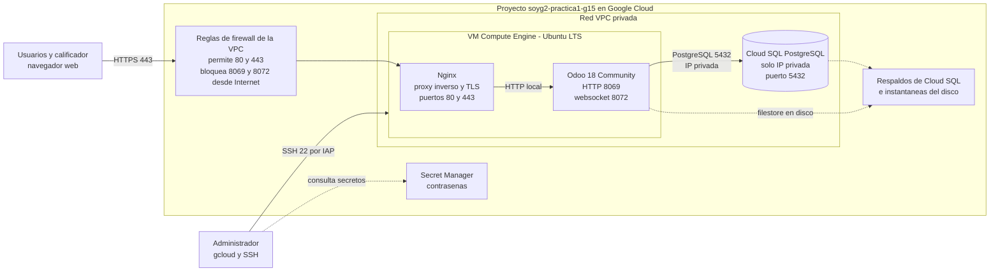
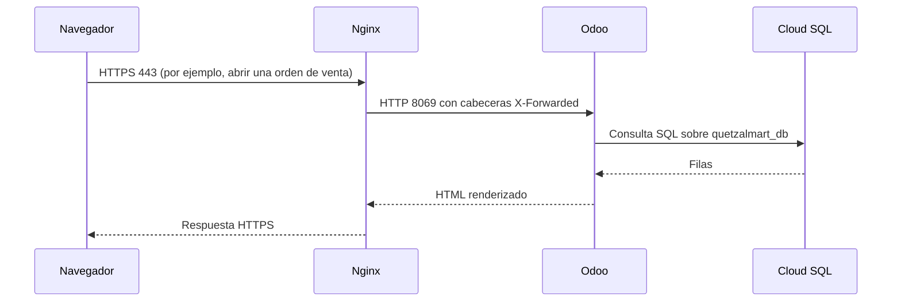

# Arquitectura del ERP Odoo en Google Cloud

Documento técnico de la infraestructura del ERP de QuetzalMart (proyecto único de SOG2, USAC). Describe cómo está compuesta la solución, cómo se conectan sus partes y qué reglas de seguridad aplican. Lo usa el equipo como referencia común.

## 1. Estado actual

El 2026-10-14 `gcloud` mostró facturación deshabilitada y ningún recurso. Una consulta nueva por las API de GCP el 2026-10-17 mostró el siguiente estado del proyecto `soyg2-practica1-g15`:

| Elemento | Estado |
|---|---|
| Proyecto de Google Cloud | Existe |
| Facturación | Habilitada |
| Instancias de Compute Engine | 1: `quetzalmart-odoo`, encendida, `e2-standard-2`, IP reservada `136.116.120.10` |
| Instancias de Cloud SQL | 1: `quetzalmart-postgres`, PostgreSQL 16, `db-f1-micro`, solo IP privada, respaldos habilitados |
| Base y usuario | `quetzalmart_db` y `odoo` existen |
| Servicio web | Odoo Community 18 activo; Nginx publica HTTPS con certificado de Let's Encrypt para la IP |
| Respaldos | Cloud SQL automático e instantáneas diarias del disco de Odoo; instantánea inicial verificada |

El estado y los pasos pendientes están en [despliegue_odoo_gcp.md](despliegue_odoo_gcp.md).

## 2. Alcance

Requisitos del enunciado que cubre esta infraestructura:

- Odoo Community implementado en la nube.
- Base de datos relacional implementada en la nube y consultable por SQL.
- Módulos de Ventas, Compras, Empleados y Facturas con datos cargados, visibles en la interfaz web y por consulta a la base de datos.
- Facturas en PDF disponibles en una carpeta (mínimo 50 más las generadas en la calificación).

Fuera de alcance técnico de este documento: portal web y CRM, Google Analytics, gestión documental y RPA con UiPath. Sus responsables e interfaces con Odoo se describen en [el plan de trabajo](plan_de_trabajo.md).

## 3. Arquitectura

## 4. Componentes

| Componente | Función | Detalle |
|---|---|---|
| VM de Compute Engine | Ejecuta Odoo y Nginx | Ubuntu LTS, IP externa estática |
| Odoo 18 Community | ERP: Ventas, Compras, Empleados, Facturas | Paquete instalado en Ubuntu, servicio `systemd` como usuario `odoo` y filestore en el disco de la VM |
| Nginx | Termina TLS y reenvía a Odoo | Únicos puertos públicos: 80 y 443 |
| Cloud SQL para PostgreSQL | Base de datos del ERP | Solo IP privada, respaldos automáticos |
| Secret Manager | Guarda contraseñas de Odoo y PostgreSQL | Nada de secretos en scripts ni en el repositorio; Odoo usa además `/etc/odoo/odoo.conf` con permisos `640` |
| Firewall de la VPC | Controla el tráfico entrante | Ver sección 5 |

Dimensionamiento existente: VM `e2-standard-2` (2 vCPU, 8 GB), Cloud SQL PostgreSQL 16 de tamaño `db-f1-micro`, región `us-central1`. Nombres: `quetzalmart-odoo` (VM), `quetzalmart-postgres` (instancia), `quetzalmart_db` (base) y `odoo` (usuario de base de datos).

## 5. Conexiones y puertos

| Origen | Destino | Puerto | Protocolo | Permitido desde |
|---|---|---|---|---|
| Internet | Nginx | 80 | HTTP, solo redirige a HTTPS | Cualquier origen |
| Internet | Nginx | 443 | HTTPS | Cualquier origen |
| Nginx | Odoo | 8069 | HTTP | Solo localhost |
| Nginx | Odoo | 8072 | WebSocket (`/websocket`) | Solo localhost |
| Odoo | Cloud SQL | 5432 | PostgreSQL | Solo red privada de la VPC |
| Administrador | VM | 22 | SSH | Solo a través de IAP o rango autorizado |

Reglas de diseño:

- Odoo escucha solo en `127.0.0.1` de la VM; nunca queda expuesto directamente a Internet.
- Cloud SQL no tiene IP pública. La IP privada exige configurar acceso privado a servicios (API `servicenetworking`, rango de IP reservado y peering con la VPC) antes de crear la instancia.
- Con `workers` mayor que cero, Odoo atiende websocket en el puerto 8072 y Nginx debe reenviar `/websocket` a ese puerto.
- Con Nginx delante, Odoo debe iniciar con `proxy_mode = True`.

## 6. Flujo de una petición

## 7. Seguridad

- **Secretos:** ninguna contraseña se escribe en scripts, documentos ni en el repositorio. Hay copias en Secret Manager y la configuración real de Odoo está en `/etc/odoo/odoo.conf` con permisos `640`, propietario `odoo`. `odoo.conf` está en `.gitignore`.
- **Base de datos:** Odoo usa un usuario dedicado `odoo` con permisos sobre `quetzalmart_db`. No usa la cuenta administrativa `postgres`.
- **Consultas de demostración:** se ejecutan con un usuario de solo lectura, distinto del que usa Odoo.
- **Administración:** inicio de sesión con cuentas personales de Google; no se comparten credenciales.
- **Trabajo compartido:** cada integrante usa una cuenta propia en Odoo, con permisos para su bloque. El Integrante 1 administra la infraestructura de GCP; los demás no necesitan administrar la VM para operar sus módulos. UiPath usa una cuenta de integración limitada a los modelos necesarios y accede a Odoo por HTTPS. Las consultas SQL se hacen mediante acceso seguro de solo lectura, sin publicar PostgreSQL en Internet.
- **Costos:** Cloud SQL y la VM facturan mientras existen. Se apagan o eliminan al terminar la calificación.

## 8. Responsabilidades de carga

El equipo acordó PostgreSQL en GCP y distribuyó el trabajo por bloques. Estas son las cantidades mínimas del enunciado y el responsable principal de prepararlas y comprobarlas:

| Dato | Mínimo del enunciado | Responsable principal |
|---|---:|---|
| Ventas | 150 | Integrante 1 |
| Cotizaciones | 20 | Integrante 1 |
| Compras con factura | 100 | Integrante 1 |
| Materiales | 60 | Integrante 1, coordinando el catálogo con Integrante 2 |
| Facturas PDF | 50 | Integrante 1 |
| Empleados | 35 | Integrante 3 |
| Cargos | 6 | Integrante 3 |
| Departamentos | 5 | Integrante 3 |
| Documentos de respaldo | 15 | Integrante 3 |

La carga inicial del ERP se coordina entre los responsables. El Integrante 3 desarrolla además la carga dinámica de clientes y productos desde los Excel entregados durante la evaluación, mediante UiPath y una interfaz autenticada de Odoo; véase [el diseño del RPA](diseno_rpa_excel.md). Cada cifra debe poder comprobarse en la interfaz y con una consulta SQL sobre PostgreSQL en la nube.

## 9. Decisiones abiertas

1. PostgreSQL queda elegido por el equipo. Registrar en los manuales que el enunciado enumera otros motores, mientras Odoo usa PostgreSQL.
2. El equipo aún no tiene dominio. Se emitió un certificado público para la IP reservada; comprobar su renovación automática periódicamente.
3. Medir el dimensionamiento existente de la VM y Cloud SQL con la carga del proyecto.
4. Definir quién unifica la sección 2 del Manual 1 (funcionamiento de cada módulo). Cada integrante aportará el funcionamiento de su bloque.
