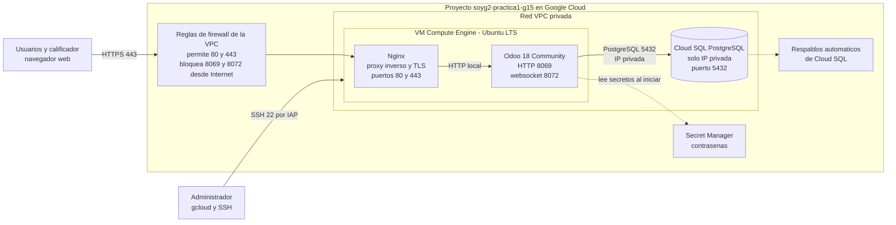
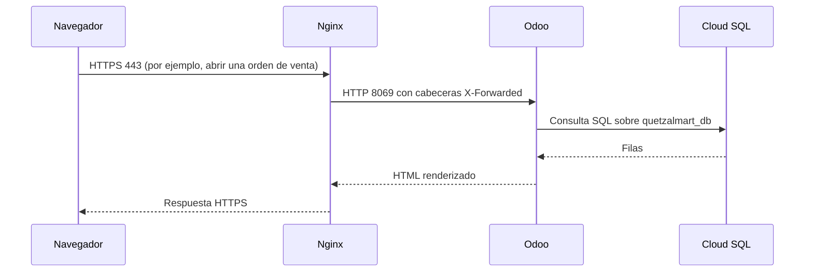

# Arquitectura del ERP Odoo en Google Cloud

Documento técnico de la infraestructura del ERP de QuetzalMart (proyecto único de SOG2, USAC). Describe cómo está compuesta la solución, cómo se conectan sus partes y qué reglas de seguridad aplican. Lo usa el equipo como referencia común.

## 1. Estado actual

Verificado con `gcloud` el 2026-10-14 sobre el proyecto `soyg2-practica1-g15`:

| Elemento | Estado |
|---|---|
| Proyecto de Google Cloud | Existe |
| Facturación | Deshabilitada (bloquea crear VM y Cloud SQL) |
| Instancias de Compute Engine | 0 |
| Instancias de Cloud SQL | 0 |
| Odoo instalado | No |

Nada de lo descrito en las secciones siguientes está desplegado todavía. Es el diseño objetivo. Cada recurso se marcará como desplegado aquí cuando exista y se haya comprobado.

## 2. Alcance

Requisitos del enunciado que cubre esta infraestructura:

- Odoo Community implementado en la nube.
- Base de datos relacional implementada en la nube y consultable por SQL.
- Módulos de Ventas, Compras, Empleados y Facturas con datos cargados, visibles en la interfaz web y por consulta a la base de datos.
- Facturas en PDF disponibles en una carpeta (mínimo 50 más las generadas en la calificación).

Fuera de alcance de este documento: portal web y CRM, Google Analytics, gestión documental y RPA con UiPath, a cargo de otros integrantes.

## 3. Arquitectura

## 4. Componentes

| Componente | Función | Detalle |
|---|---|---|
| VM de Compute Engine | Ejecuta Odoo y Nginx | Ubuntu LTS, IP externa estática |
| Odoo 18 Community | ERP: Ventas, Compras, Empleados, Facturas | Servicio systemd, usuario del sistema sin privilegios |
| Nginx | Termina TLS y reenvía a Odoo | Únicos puertos públicos: 80 y 443 |
| Cloud SQL para PostgreSQL | Base de datos del ERP | Solo IP privada, respaldos automáticos |
| Secret Manager | Guarda contraseñas | Nada de secretos en scripts ni en el repositorio |
| Firewall de la VPC | Controla el tráfico entrante | Ver sección 5 |

Dimensionamiento propuesto, pendiente de confirmación por el equipo: VM `e2-standard-2` (2 vCPU, 8 GB), Cloud SQL PostgreSQL 16 de tamaño `db-f1-micro`, región `us-central1`. Nombres propuestos: `quetzalmart-odoo` (VM), `quetzalmart-postgres` (instancia), `quetzalmart_db` (base) y `odoo` (usuario de base de datos).

## 5. Conexiones y puertos

| Origen | Destino | Puerto | Protocolo | Permitido desde |
|---|---|---|---|---|
| Internet | Nginx | 80 | HTTP, solo redirige a HTTPS | Cualquier origen |
| Internet | Nginx | 443 | HTTPS | Cualquier origen |
| Nginx | Odoo | 8069 | HTTP | Solo localhost |
| Nginx | Odoo | 8072 | WebSocket (`/websocket`) | Solo localhost |
| Odoo | Cloud SQL | 5432 | PostgreSQL | Solo red privada de la VPC |
| Administrador | VM | 22 | SSH | Solo a través de IAP o rango autorizado |

Reglas de diseño:

- Odoo escucha en `127.0.0.1`; nunca queda expuesto directamente a Internet.
- Cloud SQL no tiene IP pública. La IP privada exige configurar acceso privado a servicios (API `servicenetworking`, rango de IP reservado y peering con la VPC) antes de crear la instancia.
- Con `workers` mayor que cero, Odoo atiende websocket en el puerto 8072 y Nginx debe reenviar `/websocket` a ese puerto.
- Con Nginx delante, Odoo debe iniciar con `proxy_mode = True`.

## 6. Flujo de una petición

## 7. Seguridad

- **Secretos:** ninguna contraseña se escribe en scripts, documentos ni en el repositorio. Se leen de variables de entorno o de Secret Manager. Los archivos con configuración real (`odoo.conf`, `.env`) están en `.gitignore`; solo se versiona un archivo `.example`.
- **Base de datos:** Odoo usa un usuario dedicado `odoo` con permisos sobre `quetzalmart_db`. No usa la cuenta administrativa `postgres`.
- **Consultas de demostración:** se ejecutan con un usuario de solo lectura, distinto del que usa Odoo.
- **Administración:** inicio de sesión con cuentas personales de Google; no se comparten credenciales.
- **Costos:** Cloud SQL y la VM facturan mientras existen. Se apagan o eliminan al terminar la calificación.

## 8. Datos que carga el Integrante 1

Cantidades mínimas del enunciado y la porción que corresponde a este bloque:

| Dato | Mínimo del enunciado | Porción del Integrante 1 |
|---|---|---|
| Ventas | 150 | 50 |
| Cotizaciones | 20 | 7 |
| Empleados | 35 | 12 |
| Cargos | 6 | 2 |
| Departamentos | 5 | 2 |
| Compras con factura | 100 | 33 |
| Materiales | 60 | 20 |
| Facturas | 50 | 17 |
| Documentos de respaldo | 15 | 5 |

La carga se hace por la API externa de Odoo (XML-RPC) con scripts, no a mano. Cada cifra debe poder comprobarse con una consulta SQL sobre la base de datos en la nube.

## 9. Decisiones abiertas

1. Confirmar con el docente que PostgreSQL es aceptable. El enunciado lista MySQL, Oracle y SQL Server, pero Odoo solo soporta PostgreSQL de forma oficial.
2. Definir un dominio real para HTTPS. El enunciado no lo exige; sin dominio se puede acceder por IP, pero el certificado público no aplica de la misma forma.
3. Confirmar el dimensionamiento de la sección 4.
4. Habilitar la facturación del proyecto de Google Cloud.
5. Definir quién redacta la sección 2 del Manual 1 (funcionamiento de cada módulo), que no estaba asignada.
